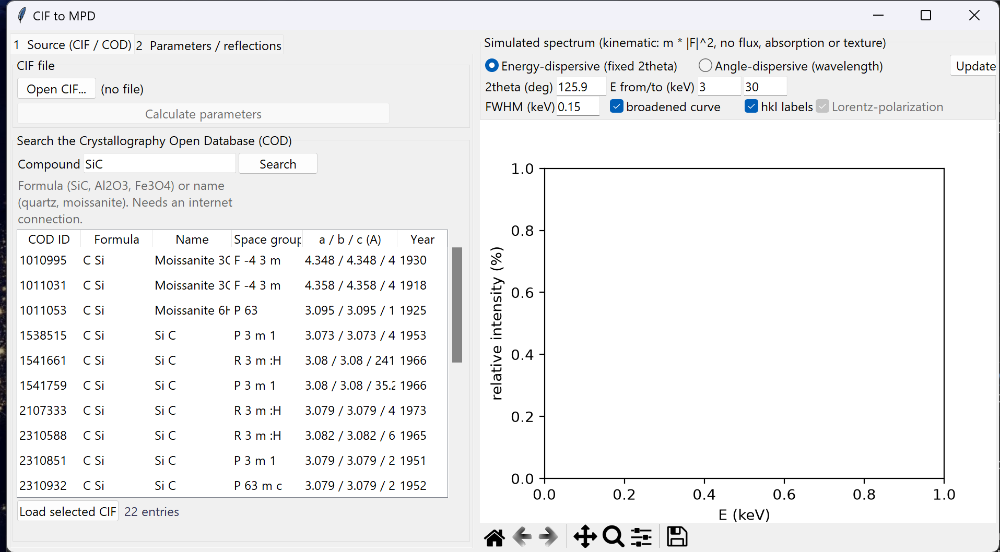
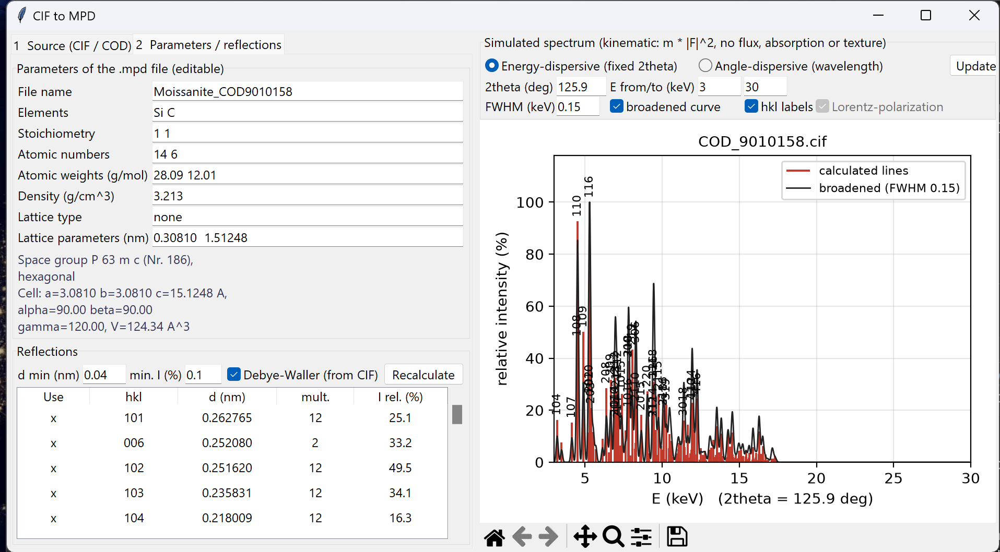

# CIF to MPD: Kurzanleitung

Das Programm erzeugt aus einer CIF-Datei (Kristallstruktur) eine EDDIDAT-Materialdatei (`.mpd`) und simuliert dazu das Beugungsspektrum. Die CIF-Datei kann lokal geladen oder direkt in der Crystallography Open Database (COD) gesucht werden.

## 1. Programm starten

`CIF_to_MPD.exe` doppelklicken. Es wird keine Installation und kein Python benötigt. Für die COD-Suche muss der Rechner eine Internetverbindung haben.

## 2. CIF-Datei beschaffen (Reiter "1 Source")

**Variante A: Suche in der COD**

1. Im Feld **Compound** eine Formel (`SiC`, `Al2O3`, `Fe3O4`) oder einen Namen (`quartz`, `moissanite`) eingeben und **Search** drücken (oder Enter).
2. In der Trefferliste den passenden Eintrag markieren. Unter der Liste erscheinen Titel, Zeitschrift sowie Temperatur und Druck der Messung. Ein Klick auf einen Spaltenkopf sortiert die Liste.
3. **Load selected CIF** drücken oder doppelklicken. Die Datei wird geladen, die Parameter werden berechnet, und das Programm wechselt zum Reiter "2 Parameters / reflections".

Zu einer Verbindung gibt es oft mehrere Einträge (verschiedene Autoren, Temperaturen, Polytypen). Hilfreich zur Auswahl sind die Spalten Raumgruppe und Zelle (a / b / c) sowie das Jahr.

**Variante B: Lokale Datei**

**Open CIF...** drücken und die Datei wählen, dann **Calculate parameters**.

## 3. Parameter und Reflexe kontrollieren (Reiter "2")

**Parameters of the .mpd file.** Alle Felder sind editierbar und werden genau so in die Datei geschrieben:

| Feld | Bedeutung |
|---|---|
| File name | Name der `.mpd`-Datei (ohne Endung) |
| Elements, Stoichiometry | Elemente und ihr gekürztes Verhältnis |
| Atomic numbers, Atomic weights | Ordnungszahlen und Atomgewichte (g/mol) |
| Density | Dichte (g/cm³), aus Zelle und Inhalt berechnet |
| Lattice type | immer `none` (die d-Werte stehen explizit in der Liste) |
| Lattice parameters | Gitterparameter in nm (kubisch: a; hexagonal und trigonal: a und c; sonst a, b, c) |

Darunter stehen Raumgruppe und Zellparameter zur Kontrolle. Bei monoklinen und triklinen Zellen erscheint ein Hinweis, weil das Format die Winkel nicht speichert.

**Reflections.** Hier steht die berechnete Reflexliste:

- **d min (nm)** ist der kleinste d-Wert. **min. I (%)** blendet Reflexe unter dieser relativen Intensität aus. **Debye-Waller** schaltet die Temperaturfaktoren aus der CIF ein oder aus. **Recalculate** rechnet neu.
- Die Tabelle zeigt hkl, d (nm), Multiplizität und relative Intensität.
- Ein **Doppelklick** auf eine Zeile schließt den Reflex aus (x verschwindet) oder nimmt ihn wieder auf. **All** und **None** schalten alle Zeilen um. Nur markierte Reflexe kommen in die `.mpd`-Datei und ins Spektrum.

## 4. Spektrum simulieren (rechts)

- **Energy-dispersive:** Linien bei E = hc / (2 d sin θ) für ein festes **2theta** (Vorgabe 16°, Energiebereich 10 bis 100 keV). **E from/to** legt den Energiebereich fest.
- **Angle-dispersive:** Linien bei 2θ für eine **Radiation** (Ag, Mo, Cu, Co, Fe, Cr Kα1). **2theta from/to** legt den Winkelbereich fest. **Lorentz-polarization** schaltet den Lorentz-Polarisationsfaktor zu.
- **FWHM** ist die Breite der verbreiterten Kurve (**broadened curve**). **hkl labels** beschriftet die stärksten Linien. **Update plot** zeichnet neu (das Diagramm aktualisiert sich auch beim Ein- und Ausschließen von Reflexen).
- Die Werkzeugleiste unter dem Diagramm erlaubt Zoomen, Verschieben und Speichern als Bild.

Die Intensitäten sind kinematisch (Multiplizität × |F|²). Quellenspektrum, Detektoreffizienz, Absorption, Textur und Fluoreszenzlinien sind nicht enthalten. Für energiedispersive Messungen zeigt das Spektrum daher nur die Intensitätsverhältnisse der Linien.

## 5. Als .mpd exportieren

1. **Export .mpd...** (unten links) drücken.
2. Zielordner und Namen wählen. Vorgeschlagen wird `Data\Materials` von EDDIDAT, wenn das Programm aus dem EDDIDAT-Ordner gestartet wird, sonst der zuletzt benutzte Ordner.
3. Nach dem Speichern erscheint die Zahl der geschriebenen Reflexe.

Das Format erlaubt nur einstellige Indizes. Reflexe mit einem Index ≥ 10 werden weggelassen, die Anzahl steht in der Meldung. Bei Strukturen mit langer c-Achse (z. B. 6H-SiC) sind das bei d min = 0,04 nm viele. Mit einem größeren **d min** bleiben weniger Reflexe übrig, und die Liste enthält nur noch die einstelligen.

In EDDIDAT liegt die Datei in `Data\Materials`. Nach dem Neustart der GUI erscheint sie im Dropdown "Select mpd file".

## 6. Hinweise

- Wenn die COD-Suche eine Fehlermeldung zeigt, noch einmal **Search** drücken. Der COD-Server bricht Verbindungen gelegentlich ab, das Programm wiederholt die Anfrage schon automatisch bis zu siebenmal.
- Sehr allgemeine Suchbegriffe (z. B. nur ein Elementname) werden abgebrochen. Dann besser die Formel eingeben.
- Geladene CIF-Dateien liegen im Ordner `%USERPROFILE%\.cif_to_mpd\cache`. Die zuletzt benutzten Ordner stehen in `%USERPROFILE%\.cif_to_mpd.json`.
- Vor dem Produktiveinsatz eine erzeugte `.mpd` einmal in EDDIDAT laden und die Reflexlinien prüfen.
